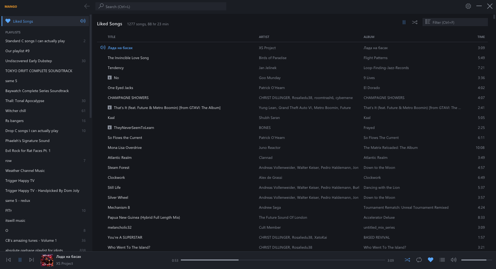

# Mango

A small, compact Spotify player for Windows: C++, Win32 + Direct3D 11 + Dear
ImGui, styled like kitchensink. Your playlists and Liked Songs down the
left, one line per song, search (songs, artists, albums, playlists), album
and artist pages, and a slim player along the bottom. No home feed, nothing
"made for you".

## Your own Spotify app

Spotify's development mode lets an app be used only by the accounts its
owner allows, so to build Mango for yourself, create an app at
developer.spotify.com/dashboard (Web API, redirect URI
`http://127.0.0.1:46075/callback`) and put its Client ID in `kClientId` in
`src/app.cpp`. You need Spotify Premium.

## How it plays

- **Browsing** uses the Spotify Web API, signed in with authorisation code +
  PKCE (no client secret). Redirect URI `http://127.0.0.1:46075/callback`;
  Mango listens there once while signing in. The refresh token is kept
  DPAPI-encrypted in `%APPDATA%\mango\config.json`.
- **Sound** comes from Spotify Soloist, Spotify's own headless Connect
  player, which Mango downloads from Spotify into
  `%LOCALAPPDATA%\Programs\mango\soloist\` and runs hidden (below-normal
  priority, killed with Mango) with its WebSocket API on 127.0.0.1. Builds
  expire after 90 days (exit code 10); Mango then fetches the current one.
  Soloist needs its own API key (developer dashboard, Soloist API Key page),
  pasted into Mango and kept DPAPI-encrypted, and is signed in once by
  picking "Mango" as the device in a Spotify app on the same network. On a
  PC with Tailscale or WSL, Soloist announces itself (mDNS) on one of those
  adapters, not Ethernet, so phones never see it: pair from the Spotify
  desktop app on the same PC instead (worked 11 Nov 2026). It also needs an
  inbound firewall rule for `soloist.exe` (private networks), which Windows
  never offers as Soloist runs hidden. Its
  data and log are in `%LOCALAPPDATA%\mango\soloist\`.
- Starting a song within a playlist/album/Liked Songs goes through the Web
  API's `PUT /me/player/play` with Soloist's device id (Soloist can only
  start a whole context); pause, skip, seek, volume, shuffle, repeat and
  the queue go straight to Soloist.

Spotify's development-mode limits (February 2026): search returns 10 a page
per type, and only playlists you own or collaborate on list their songs;
others can still be played.

## Keys

Space play/pause · Ctrl+Left/Right previous/next · Ctrl+Up/Down volume ·
Ctrl+L search · Ctrl+F filter · Enter play selected · Alt+Left or mouse back
button: back · F5 reload.

Mango registers with Windows' media controls (SMTC): what's playing shows
in the volume overlay and anything reading media sessions (kitchensink's
Now playing), and the media keys reach it when it's the current player.

## kitchensink

Mango is hidden and shown by the mango on kitchensink's title bar (window
class `mango`, message `WM_APP + 2`), like Lick of the Day. Hiding keeps the
music playing; the title bar's close quits.

## Building

`build.bat` (Visual Studio 2022 C++ tools) builds `build\mango.exe` and runs
`build\tests.exe`. Built with `/DNDEBUG`. `tools/icon.py` draws `src/app.ico`;
`tools/flat.py` previews kitchensink's flat mango.

Testing: `MANGO_DATA=<folder>` uses its own config and runs beside the real
one without taking focus; `MANGO_DEMO=1` fills it with made-up music and
touches no network (`q` opens Up next); `-place x,y,w,h` sets the window.
